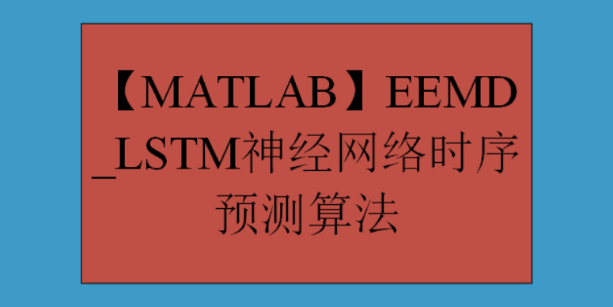

# [MATLAB] EEMD-LSTM Neural Network Time Series Forecasting Algorithm

EEMD-LSTM neural network time series prediction algorithm is a time series prediction method that combines Extended Empirical Mode Decomposition (EEMD) and Long Short-Term Memory Neural Network (LSTM).
EEMD is an improved EMD method that adds random noise to the original signal, allowing for full decomposition of the signal at various scales, thereby enhancing the integrity and accuracy of the Intrinsic Mode Functions (IMFs). By using EEMD, the original time series can be decomposed into multiple Intrinsic Mode Functions (IMFs) and a residual sequence.
LSTM is a popular deep learning method in neural networks, especially with unique advantages in handling long-term sequential problems. The internal structure of LSTM consists of forget gate, input gate, output gate, and memory units. Through the interaction of these gating units, LSTM can learn the long-term dependencies in the time series.
The basic idea of the EEMD-LSTM algorithm is to decompose the original time series through EEMD, then each IMF is used as an input for the LSTM model, which uses the LSTM model to predict each IMF. By constructing multiple independent LSTM models with different initialization conditions and parameter settings, each LSTM model will train and predict the time series, and finally, their predicted results are integrated, such as by averaging or weighted average, to obtain the final prediction result.
The advantage of the EEMD-LSTM algorithm lies in its ability to establish multiple models through different initialization conditions and parameter combinations, increasing the diversity of the model and improving overall prediction accuracy. At the same time, EEMD can more accurately extract complex patterns in the time series, helping to improve prediction accuracy.
The EEMD-LSTM algorithm has broad application prospects in the field of time series prediction, particularly suitable for handling nonlinear and non-stationary signals. By combining the advantages of EEMD and LSTM, this algorithm can better capture complex patterns in time series, enhancing the accuracy and stability of predictions. In practical applications, the EEMD-LSTM algorithm can be applied to various fields such as financial market forecasting, meteorological forecasting, energy consumption prediction, etc.

## Images

<!-- PAYMENT_BLOCK -->

## Get this dataset

- Payment link (Stripe): [Buy now](https://buy.stripe.com/3cs8yP7sY87d0vu9AB)
- Payment QR code: 

<!-- /PAYMENT_BLOCK -->
